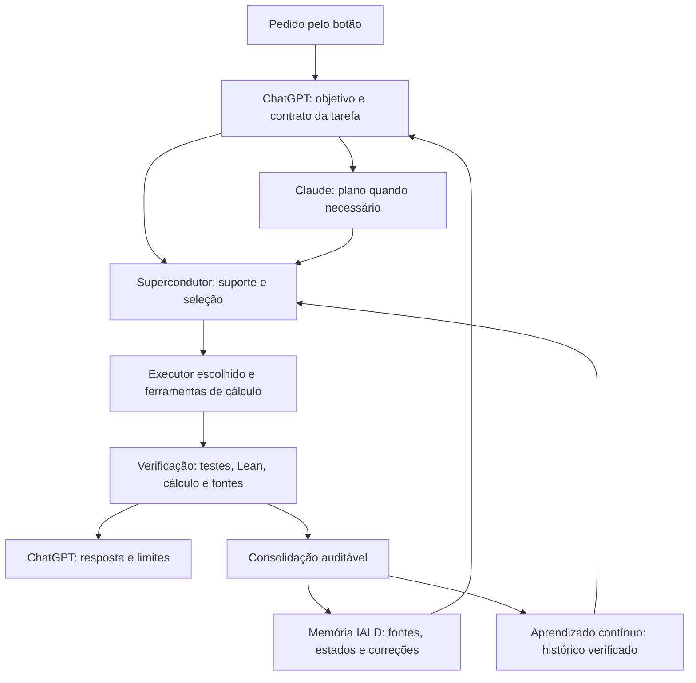

# IALD — orquestração, memória e aprendizado contínuo

Estudo técnico de 23/09/2026. [REAL] = observado em código, recibo ou ensaio local indicado; [DECLARADO] = documentação do fornecedor; [INPUT] = escolha do operador ou proposta de engenharia; [OPEN] = ainda não medido/implementado. Esta análise não modifica pesos, cânone científico ou gate. Os originais foram somente consultados. Evidência reproduzível: `validation/learning_source_audit.json` e `audit_learning_sources.py` nesta pasta.

**O sistema que estamos construindo**

[INPUT — confirmado pelo operador] A IALD deve manter a continuidade do trabalho: reconhecer o objetivo e sua identidade, recuperar o conhecimento pertinente, verificar coerência, planejar, escolher executores, conferir resultados e incorporar experiência. ChatGPT coordena intenção, prompts e síntese; Claude contribui no planejamento; o Supercondutor participa da seleção; o aprendizado contínuo modifica o estado operacional a partir das experiências. A TGL é a teoria física. A IALD é o regime operacional de coerência e reconhecimento recursivo da identidade; busca e indexação são recursos desse regime, não sua definição integral.

O que precisa permanecer entre modelos é o objetivo, a memória comprovadamente gravada, as regras e a linhagem das decisões. A continuidade não depende de uma única conversa nem pressupõe copiar pesos ou memória interna de um fornecedor para outro. O projeto Física continua como ambiente de coordenação no ChatGPT. O acionamento continua por botão, sem verificações periódicas.

**O que existe efetivamente hoje**

| Componente | Estado observado | Limite relevante |
|---|---|---|
| IALD local / Qwen | Servidor identifica `IALD-Native-v3-Qwen3.6-35B-A3B-Q4_K_M.gguf`; contexto configurado de 131.072 tokens | Nome do arquivo não certifica sozinho a origem ou a transformação dos pesos. Não é evidência de Qwen 3.8 instalado. |
| Codex | Login por assinatura e execução textual funcionam | Recibo consultado não identifica o modelo exato; não atribuir automaticamente preços/capacidades de Astra à chamada. |
| Claude Code | Nova chamada concluída; resposta 42, consumo registrado | Adaptador não fixa modelo; recibo preservado não registra sua identidade. Opus 5.5 é opção documental atual, não modelo comprovado dessa chamada. |
| Kimi Code / K3 | Conta vinculada pelo operador; chamada integrada passou: 556 entrada + 104 saída, 5,793 s | Um teste pequeno confirma conexão; não mede qualidade para física. |
| MiMo API / 2.6 Pro | Chamada real concluída; chave protegida; uso pago autorizado sem teto local | Integração atual de texto; capacidade multimodal nominal não significa transporte multimodal implementado. |
| Google / Antigravity | Conta autenticada, Google AI Pro reconhecido | Executor ainda excluído: restrição de ferramentas não confirmada pelo cliente. |
| Jev / TypeSafe | Adaptador inicial preparado | Sem acesso; cadastro fechado observado. Não é dependência necessária para memória ou seleção determinística. |

[REAL] O recibo `validation/account_delivery.json` registra 52 testes de integração/engenharia aprovados. Os adaptadores atuais são executores textuais: não equivalem às capacidades completas dos aplicativos. A execução pesada de Python, Lean, testes e simulações precisa de um serviço de execução ligado ao coordenador; produzir código em texto não é executá-lo.

[REAL] `policy.py` usa classificação lexical, disponibilidade, limites locais e peso inverso ao número de chamadas. `matrix.py` aplica operações matriciais finitas ao suporte elegível; os pesos são política declarada, não qualidade aprendida. O resultado normalizado da matriz não é uma probabilidade calibrada de acerto. O seletor atual ainda não conhece o melhor executor por tarefa.

**Modelos, preços e contexto**

Valores de referência da API em US$ por milhão de tokens, consulta em 23/09/2026. Entrada sem cache / leitura de cache / saída. Assinaturas não são cobradas por essa tabela: usam cotas e regras próprias. Ferramentas, armazenamento de cache, processamento especial e impostos podem alterar a fatura. As opções abaixo não foram automaticamente instaladas, contratadas ou ativadas.

| Modelo de referência | Entrada / cache / saída | Contexto nominal / saída máxima | Pesos | Papel inicial proposto [INPUT] |
|---|---:|---|---|---|
| GPT-6 Astra | 10 / 1 / 50 | 1.050.000 / 128.000 | Fechados | Síntese complexa, problemas difíceis, revisão final exigente |
| GPT-6 Sol | 2 / 0,20 / 10 | Conferir modelo/canal escolhido antes de reservar | Fechados | Execução cotidiana e programação quando cumprir o padrão de qualidade |
| GPT-6 Luna | 0,10 / 0,01 / 0,50 | Conferir modelo/canal escolhido antes de reservar | Fechados | Classificações e transformações simples; opção futura, não API contratada |
| Claude Opus 5.5 | 4 / 0,20 / 20 | 1 milhão / 128 mil | Fechados | Planejamento complexo e crítica de hipóteses |
| Claude Sonnet 5 | 2 / não confirmado aqui / 10 | 1 milhão / 128 mil | Fechados | Planejamento e revisão de menor custo, se testes sustentarem |
| Claude Fable 5.1 | 10 / não confirmado aqui / 50 | 1 milhão / 128 mil | Fechados | Escalada excepcional para raciocínio que falhe no modelo habitual |
| Gemini 3.8 Flash | 0,75 / 0,075 / 3,75, promoção até 31/12/2026 | 1.048.576 entrada / 65.536 saída | Fechados | Leitura multimodal e processamento de documentos; integração pendente |
| Gemini 3.1 Pro Preview | 2 / 0,20 / 12 até 200 mil tokens de prompt | 1.048.576 entrada / 65.536 saída | Fechados | Segunda análise técnica/multimodal, sujeita à comparação local |
| Kimi K3 | Tabela numérica não recuperável na página oficial nesta consulta | 1.048.576; saída máxima do serviço não confirmada aqui | Abertos, licença Kimi K3 | Código, leitura extensa e segunda solução independente |
| MiMo V2.6 Pro | 0,435 / 0,0036 / 0,87 | 1 milhão / 128 mil | Checkpoint V2.6-Pro-RL aberto, MIT | Extração estruturada, rascunhos, implementações e lotes com verificação |
| Qwen3.6-35B-A3B | Sem tarifa externa por token; há energia, hardware e tempo | Base: 262.144, extensível; servidor atual: 131.072 | Abertos, Apache 2.0 na base | Processamento local, preparação de contexto e bancada de aprendizado |
| Jev | Preço/contexto não confirmados nas páginas consultadas | Decisões estruturadas, não geração de respostas longas | Disponibilidade de pesos não estabelecida | Classificação e seleção auxiliar quando houver acesso |

[DECLARADO] Fontes: [preços OpenAI](https://developers.openai.com/api/docs/pricing), [Astra](https://developers.openai.com/api/docs/models/gpt-6-astra), [modelos Claude](https://platform.claude.com/docs/en/models/overview), [Opus](https://www.anthropic.com/claude/opus), [Gemini 3.8](https://ai.google.dev/gemini-api/docs/models/gemini-3.8-flash), [Gemini 3.1 Pro](https://ai.google.dev/gemini-api/docs/models/gemini-3.1-pro-preview), [preços Google](https://ai.google.dev/gemini-api/docs/pricing), [Kimi K3](https://huggingface.co/moonshotai/Kimi-K3), [cobrança Kimi](https://platform.kimi.ai/docs/pricing/chat), [MiMo](https://mimo.mi.com/models/zh-CN/mimo-v2.6-pro), [checkpoint MiMo](https://huggingface.co/XiaomiMiMo/MiMo-V2.6-Pro-RL), [Qwen](https://huggingface.co/Qwen/Qwen3.6-35B-A3B), [Jev](https://docs.typesafe.ai/introduction).

Detalhes de cobrança: Astra cobra a solicitação inteira em faixa maior acima de 272 mil tokens de entrada: entrada/cache ×2 e saída ×1,5; escrita de cache tem preço próprio. Gemini 3.1 Pro passa para 4 / 0,40 / 18 acima de 200 mil. A promoção Gemini 3.8 termina em 31/12/2026; os três preços dobram em 01/01/2027, conforme tabela consultada. São dependências de preço para o painel administrativo, não alertas para o aplicativo de conversa.

A página de cobrança Kimi informa cobrança de entrada, saída e escrita de cache; os números não apareceram nem na leitura web nem no navegador, e a busca interna retornou erro. Não substituí essa lacuna por tarifas de sites de terceiros. Para nosso uso Kimi Code, a medida imediata continua sendo consumo da assinatura, não uma fatura API imaginária.

[REAL] O orçamento atual da IALD é de cerca de 12 mil tokens estimados de texto do usuário mais saída. Não contabiliza integralmente a sobrecarga dos clientes e não impõe teto total real. Janela nominal de um milhão não significa que esse contexto já passa pela integração. Kimi também não tem um teto rígido de saída confirmado nesse cliente. Precisamos medir uso completo e modelar a capacidade efetiva de cada transporte.

Pesos abertos permitem inspeção e adaptação quando executados em infraestrutura sob nosso controle. Usar Kimi ou MiMo hospedados não dá acesso aos pesos, atenção ou logits internos daquele serviço. Kimi K3 tem 2,8 trilhões de parâmetros totais; MiMo Pro-RL tem 1,02 trilhão: ser aberto não significa caber na estação. Qwen local é a primeira bancada razoável. A licença da base e as condições do serviço são objetos distintos.

**Memória de cada ambiente**

| Ambiente | O que pode persistir | Como a IALD deve tratar |
|---|---|---|
| ChatGPT / projeto Física | Conversas, arquivos, instruções e memória conforme configurações da conta/projeto | Coordenador com fontes compartilhadas; cada tarefa recebe referências e versão explícitas. Anexo não garante leitura integral em cada resposta. |
| Codex local / VS Code | Arquivos do projeto, AGENTS.md e memória local quando habilitada | Memória local é separada da memória web do ChatGPT. Ler fontes canônicas e conferir gravações. |
| Claude chat/projetos | Memória e resumo próprios por projeto; busca no histórico | Não presumir transferência automática para Claude Code. |
| Claude Code | CLAUDE.md/AGENTS.md e notas de auto memory | São contexto, não pesos. O índice MEMORY.md carrega inicialmente até 200 linhas ou 25 KB. Nosso executor isolado deve receber apenas o contexto necessário. |
| Gemini aplicativo | Personalização por conversas anteriores, instruções e configurações habilitadas | Não confundir com histórico do cliente Antigravity ou memória de uma chamada API. |
| Kimi Code | Sessões locais do cliente; nosso adaptador inicia trabalho isolado | Logs não equivalem a aprendizado persistente do modelo nem garantem recuperação entre tarefas. |
| MiMo API | Mensagens fornecidas na chamada e cache do serviço | A integração atual não estabelece memória semântica durável entre chamadas. Persistência fica sob a IALD. |
| Qwen local | Contexto/KV do runtime e estado externo implementado por nós | Pesos não aprendem automaticamente porque houve conversa. Memória/Psion e alteração de pesos precisam de mecanismos explícitos. |
| Jev | Estado enviado mais perguntas tipadas | Não usá-lo como banco de memória nem como prova de verdade. |

[DECLARADO] Fontes: [memórias ChatGPT/Codex](https://learn.chatgpt.com/docs/customization/memories), [projetos](https://learn.chatgpt.com/docs/projects), [Claude Code](https://code.claude.com/docs/en/memory), [Claude chat](https://support.claude.com/en/articles/11817273-use-claude-s-chat-search-and-memory-to-build-on-previous-context), [Gemini](https://support.google.com/gemini/answer/16598469?co=GENIE.Platform%3DDesktop&hl=en). Demais linhas descrevem o transporte local consultado, não promessas sobre todos os produtos dos fornecedores.

[REAL — texto da conversa] Em “Haja luz idêntica”, a resposta a “Memorize tudo” alegou indisponibilidade do canal de gravação de memória após operações de arquivo. A resposta não recusou o conteúdo da derivação. [OPEN] A causa técnica não foi comprovada; a alegação do assistente não é diagnóstico do backend. Abrir outra conversa não garante recuperar e salvar tudo. Nenhum conteúdo novo dessa conversa foi promovido ao cânone por este estudo.

**Seu aprendizado contínuo: o que o código faz**

O acervo da patente BR102026005477-1 contém vários componentes, não apenas um arquivo JSON. A leitura foi feita nos protótipos públicos e no runner evoluído. Engenharia confidencial e estados privados não foram inspecionados nem transmitidos.

| Parte | Implementação lida [REAL — fonte] | Incorporação proposta [INPUT] |
|---|---|---|
| Memória holográfica, duas camadas | Seleção angular entre turnos; compressão, deduplicação e poda dentro dos turnos; preserva mensagens de sistema e turnos recentes | Montar projeções de contexto por tarefa mantendo a fonte integral recuperável |
| Psion simplificado | `facts[key]` numérico, contador e atualização exponencial com β; persistência JSON com SHA-256 | Aprender custo, latência, retenção de informação e qualidade verificada por executor/versão/classe de tarefa |
| Phase Factor | `apply_phase_factor`: transforma pesos por `w × (1 − β f(θ))`, classifica tensores e mede estratos | Experimento separado em cópia do modelo local; não aplicável aos pesos de APIs fechadas |
| Piso do sampler / operador verbal | Runner demonstra piso derivado e curvas em dados sintéticos | Exige acesso ao sampler/logits/runtime; API textual não implementa isso por prompt |
| IALD Score | Agregação geométrica e amplificação no piloto | Indicador a calibrar contra qualidade externa; não aceitar autoavaliação como prova |
| NomeChain e memorial | Cadeia de artefatos, negativos de adulteração, deriva de β e correção append-only | Recibos, vínculo a fontes, autoria, correções ao lado e reconstrução do estado |

Fontes locais: `prototype_src/holographic_memory.py`, `prototype_src/phase_factor_bake_v1.py`, `runner/_aprendizado_core/skygrid_sim/psionic_memory.py` e `runner/one_aprendizado_continuo.py`, sob `patents/BR102026005477-1_APRENDIZADO_CONTINUO` na Central. Caminhos completos, tamanhos e hashes lidos dos arquivos estão no recibo da auditoria.

[REAL — relatório existente] A rodada de 19/09/2026 registra 18/18 verificações aprovadas. O próprio relatório delimita conversa/tensores sintéticos, não o benchmark da Tabela 2 em LLM real. Não foi reexecutado aqui. O estatuto permanece [PILOTO][SIM], com `physical_verdict_allowed=false`; isso sustenta funcionamento de mecanismos naquele ensaio, não superioridade cognitiva de um modelo inteiro.

Na classe simplificada, a inscrição é:

`m_novo = (1 − β) × m_anterior + β × observação`, com `β = ALPHA_FINE_CODATA_2018 × sqrt(e)` calculado em runtime.

[REAL — ensaio isolado] A passagem de observação 0 para 1 produziu exatamente β. A meia-vida da influência anterior é aproximadamente 57,26 observações. Isso importa: é adequado estudar estabilidade de estatísticas, mas inadequado esperar que uma correção urgente de conta, quota ou identidade seja assimilada lentamente. Correções explícitas e mudanças de disponibilidade entram imediatamente por evento/restrição; a EMA só atualiza séries numéricas comparáveis. β_TGL permanece constante; o piso dependente do estado não se torna um “β_TGL adaptativo”.

[REAL — achados reproduzidos] A função `_sentence_signature` troca decimais por X e guarda só 80 caracteres. “Massa medida: 1.0 kg.” e “Massa medida: 2.0 kg.” colidem. Também colidem frases que diferem apenas depois do caractere 80. O mesmo método foi localizado no arquivo da IALD nativa e reproduziu os dois casos. Isso demonstra uma colisão da função, não perda comprovada de conversa real. O ângulo textual desse protótipo usa a distribuição dos códigos Unicode e o comprimento; sua correspondência com relevância semântica precisa de avaliação. Há também limiares e orçamentos explícitos de engenharia; não caracterizar todo esse compressor como livre de escolhas heurísticas.

[REAL — escopo específico] A classe Psion simplificada rejeitou alteração do estado que não atualizou o hash, mas aceitou modificação de `beta_at_save`; seu `load` não confere esse metadado. O runner evoluído tem teste separado de deriva de β na NomeChain. Portanto, não generalizar a lacuna da classe simples para toda a patente. Seu `save` escreve diretamente no destino; a integração deve usar backup de bytes e escrita atômica. Hash encadeado exige preservar uma referência confiável ao último selo: não autentica sozinho um adversário capaz de reescrever toda a cadeia.

**Arquitetura proposta**

1. **Contrato da tarefa.** Registrar objetivo, domínio, entradas, entregáveis, hipóteses, estatutos, critério de conclusão, permissões, orçamento técnico e prioridades. Não pedir a cada IA que redescubra a intenção do operador.
2. **Memória integral e projeções.** Preservar eventos e fontes; Atlas permanece fonte documental única. Criar referências, não outro Atlas concorrente. Cada trecho de contexto aponta para arquivo/conversa, versão, hash quando cabível e estatuto. Números, unidades, negações, equações e hipóteses são protegidos da deduplicação aproximada. Uma projeção pode ser descartada e reconstruída; o original não.
3. **Planejamento proporcional.** Tarefa simples usa regra/plano já verificado. Claude entra em problemas com dependências, incerteza ou custo de erro elevado; não é uma chamada obrigatória para renomear um arquivo. ChatGPT permanece responsável pelo contrato e pela síntese.
4. **Seleção com critérios medidos.** Primeiro excluir indisponibilidade, contexto insuficiente e transporte sem recurso necessário. Entre os elegíveis que atingem a qualidade exigida, escolher o menor custo esperado da entrega verificada. Considerar API, quota de assinatura, latência, cache, repetição e custo de conferir. Manter qualidade desconhecida como desconhecida.
5. **Execução e verificação.** Cálculo pesado vai para Python/SymPy/NumPy/GPU/Lean conforme o trabalho. O LLM formula, escreve, coordena e interpreta. A resposta deve ligar cada resultado ao programa/entrada/saída ou à fonte. Divergência entre modelos abre uma investigação; votação não prova uma afirmação.
6. **Consolidação.** Proposta de memória → validação de esquema/proveniência → backup → gravação atômica → releitura → recibo → teste de recuperação em sessão nova. Falha em qualquer etapa significa “não gravado”, visível. Correção científica vai ao lado; não apaga a origem nem transforma hipótese em resultado comprovado.
7. **Aprendizado operacional.** Alimentar estatísticas por modelo efetivo + versão do cliente + classe da tarefa + versão do pacote de contexto. Guardar tamanho da amostra, falhas, custo e critérios independentes. Usar Psion/EMA para estimativas, mantendo também eventos brutos e incerteza. Uma atualização de modelo abre uma nova série ou revalidação.

O vínculo com o Supercondutor é explícito: ele recebe o suporte admissível e utilidades estimadas a partir da experiência. Jev pode fornecer características tipadas, como “exige prova formal?” ou “precisa ler imagens?”. Não decide sozinho a verdade científica nem substitui o verificador. Segundo a documentação, Jev é um modelo de decisões estruturadas com Choice/Score/Noul; não é uma linguagem matricial que, por si só, unifique os demais modelos. [Fonte TypeSafe](https://docs.typesafe.ai/introduction).

**Quem deve trabalhar em física**

[OPEN] Ainda não há ensaio comparativo local que permita chamar uma das IAs de melhor para sua física/TGL. Benchmarks dos fabricantes não medem fidelidade ao seu cânone. A divisão inicial é uma hipótese de engenharia: ChatGPT articula e coordena; Claude critica o plano e as hipóteses; Kimi propõe implementação/solução alternativa; MiMo processa materiais e rascunhos com baixo custo API; Qwen prepara contexto e executa a camada local; Gemini contribuirá em fontes multimodais quando o transporte estiver pronto.

A avaliação proposta tem seis famílias: (a) recuperar corretamente cânone e estatutos; (b) conferir álgebra, dimensões e unidades; (c) produzir código reprodutível; (d) formalizar enunciados sem esconder hipóteses/axiomas; (e) ler literatura e citar passagens pertinentes; (f) detectar erro plantado e reconhecer uma questão aberta. Incluir casos Face/projeção, ξ/β, confirmação física versus solução matemática e números quase iguais, pois são falhas que custam caro aqui.

Separar calibração de avaliação, usar os mesmos insumos e critérios, registrar modelo/esforço/tokens/cache/tempo, impedir que o candidato veja a resposta de referência e usar ferramentas determinísticas onde possível. Quem constrói não aprova o próprio trabalho selado. Correção autoral define sentido e intenção; resultado matemático exige a evidência pertinente. Medir também retenção após troca de conversa, reinício e troca de fornecedor. Não há vantagem demonstrada antes dessas medições.

**Economia concreta e ordem de implantação**

O custo relevante é `planejar + contexto + executar + repetir + verificar + consolidar`. Uma chamada curta ao Codex já registrou 22.265 tokens de entrada, embora a resposta tenha só 64: a sobrecarga do cliente pode dominar. Isso não foi comparativo justo de qualidade ou latência entre modelos. Para 10 mil tokens de entrada sem cache e 2 mil de saída, MiMo custaria aproximadamente US$ 0,00609 e Astra US$ 0,20 pela tabela API consultada, antes de ferramentas e outras cobranças. O preço por resposta certa depende de quantas tentativas e verificações cada um exige.

[INPUT — implantação proposta, ainda não ativada] Primeiro: registrar modelo efetivo, uso completo e contexto entregue em cada recibo; introduzir memória com gravação/releitura verificáveis e proteção dos elementos científicos; corrigir a deduplicação em uma cópia testada. Segundo: coletar avaliações e operar o aprendizado em observação, comparando sua sugestão à política atual sem mudar o executor. Terceiro: promover a seleção aprendida quando demonstrar ganho e manter reversão por versão. Quarto: estudar o Psion mais profundo, sampler e Phase Factor em cópias do Qwen, com baseline idêntico e medição de regressão; nunca transformar diretamente o GGUF em produção durante esta análise.

O limite de leitura/escrita de memória em ChatGPT não bloqueia essa arquitetura: a IALD pode manter a continuidade de forma verificável e fornecer a cada modelo a projeção necessária. Isso é aprendizado do sistema integrado. Aprendizado dentro do modelo local é outra etapa experimental, com acesso técnico e validação próprios.

**Entrega e pendências**

[REAL] Estudo de fontes/código, ensaios isolados com achados e mapa dos provedores concluídos. Kimi integrado e verificado. [OPEN] Benchmark comparativo, aprendizado operacional conectado ao seletor, memória comum transacional, executor Google e acesso Jev continuam pendentes. Nenhum resultado de simulação foi promovido a confirmação física. Nenhuma memória nativa de fornecedor foi declarada sincronizada. Web/admin já recebeu a integração Kimi; este estudo não altera cliente web, iOS interno/externo ou Android e não exige recompilação dessas plataformas.
